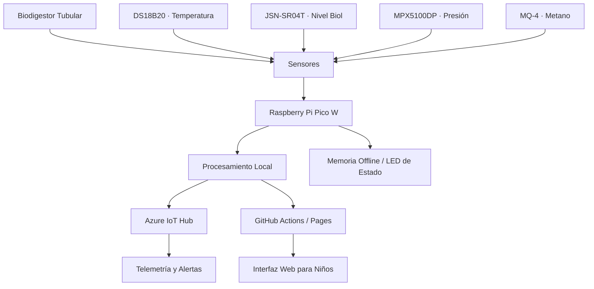

# 🌱 Sistema de Monitoreo IoT para Biodigestor Anaeróbico

<div align="center">


**Sistema de monitoreo IoT de código abierto para biodigestor anaeróbico tubular**  
*Institución Educativa San José de Canalete, Córdoba, Colombia*

</div>

---

## Descripción

Este proyecto transforma residuos pecuarios y vegetales en biogás para generar energía eléctrica, garantizando la continuidad de las actividades académicas en una zona rural con suministro eléctrico inestable.

El sistema monitorea en tiempo real cuatro variables críticas del proceso de digestión anaeróbica — temperatura, presión del biogás, nivel de biol y concentración relativa de metano — utilizando una **Raspberry Pi Pico W** y sensores de bajo costo. Los datos se transmiten de forma redundante a **Azure IoT Hub** (para telemetría robusta y tolerante a fallos) y a **GitHub Pages** (para una interfaz web educativa interactiva dirigida a los estudiantes de la institución).

---

## Planteamiento del Problema

En el municipio de Canalete, Córdoba, la inestabilidad del suministro eléctrico afecta significativamente a las instituciones educativas rurales:

| Problema | Impacto |
|----------|---------|
| Cortes de energía frecuentes | Interrupción de clases |
| Equipos pedagógicos inutilizables | Reducción de la calidad educativa |
| Residuos orgánicos sin gestión | Emisiones de metano no controladas |

### Solución Propuesta

Un sistema de biodigestión anaeróbica con monitoreo inteligente que:

- Genera energía eléctrica a partir de residuos pecuarios locales.
- Monitorea variables críticas en tiempo real mediante IoT.
- Proporciona una interfaz web lúdica para la apropiación del conocimiento por parte de los niños.
- Promueve un modelo de economía circular replicable.

---

## Arquitectura del Sistema



### Componentes del Sistema

| Función | Componente |
|---------|------------|
| Microcontrolador | Raspberry Pi Pico W |
| Sensor de Temperatura | DS18B20 |
| Sensor de Nivel de Biol | JSN-SR04T (Ultrasónico) |
| Sensor de Presión de Biogás | MPX5100DP |
| Sensor de Gas Metano | MQ-4 |
| Acondicionamiento Analógico | Divisores de voltaje (R1 = 10 kΩ, R2 = 20 kΩ) |
| Regulador de Alimentación | Módulo LM2596 con protección (Diodo 1N4007) |

### Características de Software

- **Tolerancia a fallos:** el sistema guarda los datos en la memoria flash de la Pico W si se pierde la conexión WiFi y los envía automáticamente al recuperarla.
- **Sincronización NTP:** uso de socket para obtener la hora exacta de servidores como Google o Cloudflare, asegurando que los registros tengan marcas de tiempo precisas (UTC-5).
- **Envío alineado:** los datos se envían a la web de GitHub exactamente en múltiplos de 5 minutos (ej. 13:05:00, 13:10:00) para garantizar gráficas continuas y sin saltos.
- **Persistencia semanal:** una automatización en GitHub Actions crea un nuevo archivo `.csv` cada semana en `docs/historial/` (por ejemplo `2026-W44.csv`) para mantener el repositorio ligero y rápido.

---

## Variables Monitoreadas

| Variable | Sensor | Rango Típico | Umbral Crítico |
|----------|--------|--------------|----------------|
| Temperatura | DS18B20 | 30 – 40 °C | < 25 °C o > 45 °C |
| Nivel de Biol | JSN-SR04T | 20 – 80 % | > 85 % (rebose) o < 15 % |
| Presión de Biogás | MPX5100DP | 0 – 5 kPa | > 10 kPa |
| Metano (índice Rs/R0) | MQ-4 | 0.85 – 1.05 | < 0.6 (fuga significativa) |

> **Nota:** la variable de pH fue descartada para esta fase del prototipo por limitaciones presupuestales y de calibración, quedando registrada como trabajo futuro.

---

## Interfaz Web

La página (`docs/index.html`, publicada con GitHub Pages) está pensada para niños de primaria e incluye:

- **Tarjetas con el último valor** de cada variable. Al tocarlas se muestra el sensor que la mide, con un dibujo, una explicación sencilla y un enlace a su hoja de datos.
- **Indicador de nivel de biol:** un anillo que cambia de color y mensaje (casi vacío, poco lleno, a la mitad, bastante lleno y ¡lleno!). La alerta se activa por encima del 80 %.
- **Indicador de gas en el aire:** aire limpio (Rs/R0 > 0.85), advertencia (0.6 – 0.85) o peligro (≤ 0.6), calculado con las últimas lecturas para evitar falsas alarmas.
- **Estado "Sin datos"** si no llegan lecturas nuevas por más de 15 minutos.
- **Gráficas suavizadas** de las últimas 24 horas o de toda la semana.

> El indicador de gas es educativo y no reemplaza un detector de gas certificado.

---

## Instalación y Despliegue

### Requisitos Previos

- Raspberry Pi Pico W con firmware MicroPython.
- Thonny IDE o VS Code con la extensión de MicroPython.
- Componentes listados en [`hardware/BOM.md`](hardware/BOM.md).

### Pasos de Configuración

1. Clonar el repositorio:

   ```bash
   git clone https://github.com/Rafael-blink/biodigestor-iot-san-jose.git
   cd biodigestor-iot-san-jose
   ```

2. Configurar tus credenciales de red y tokens en el archivo `main.py`:

   ```python
   WIFI_SSID = "nombre_red_wifi"
   WIFI_PASSWORD = "contraseña"
   IOT_HUB_NAME = "biodigestor-san-jose-hub"
   SAS_TOKEN = "tu_token_de_azure"
   GITHUB_TOKEN = "tu_token_de_github"
   ```

   > ⚠️ **Nunca subas tus credenciales reales a GitHub.** Usa valores de ejemplo en el repositorio y pon los reales solo en la placa. El token de GitHub debe tener los permisos mínimos necesarios (solo este repositorio).

3. Conectar los sensores a la Pico W siguiendo las conexiones especificadas en la documentación técnica (pines GP14, GP15, GP17, GP26 y GP27).

4. Copiar el archivo `main.py` a la placa mediante Thonny y guardarlo en la memoria interna.

5. Ejecutar y verificar en el monitor serial que el LED de estado se encienda (conexión exitosa).

---

## Impacto Educativo y Social

El proyecto contempla las siguientes acciones de apropiación social del conocimiento:

- Dos talleres teórico-prácticos dirigidos a docentes, estudiantes y personal de la institución.
- Desarrollo de una interfaz web con gráficas interactivas diseñada para ser comprensible por niños de primaria.
- Plan de mantenimiento comunitario para garantizar la sostenibilidad a largo plazo.

---

## Objetivos de Desarrollo Sostenible (ODS)

| ODS | Descripción |
|-----|-------------|
| ODS 4 | Educación de Calidad |
| ODS 7 | Energía Asequible y No Contaminante |
| ODS 13 | Acción por el Clima |

---

## Documentación

| Documento | Descripción |
|-----------|-------------|
| [Especificación Técnica](docs/TECHNICAL_SPECIFICATION.md) | Detalles de diseño del sistema y cálculos matemáticos |
| [Lista de Materiales](hardware/BOM.md) | Componentes y referencias comerciales |
| [Registro de Pruebas](docs/test-results/) | Historial de validación de cada sensor y pruebas de integración |

---

## Licencia

- El **software** está distribuido bajo la Licencia MIT.
- El **hardware** es de código abierto bajo la CERN Open Hardware Licence v2 - Strongly Reciprocal (CERN-OHL-S-2.0).

---

## Contacto

**Rafael Gustavo Ramos Noriega**  
Correo: rafael.ramosn@upb.edu.co  
Universidad Pontificia Bolivariana — Seccional Montería
